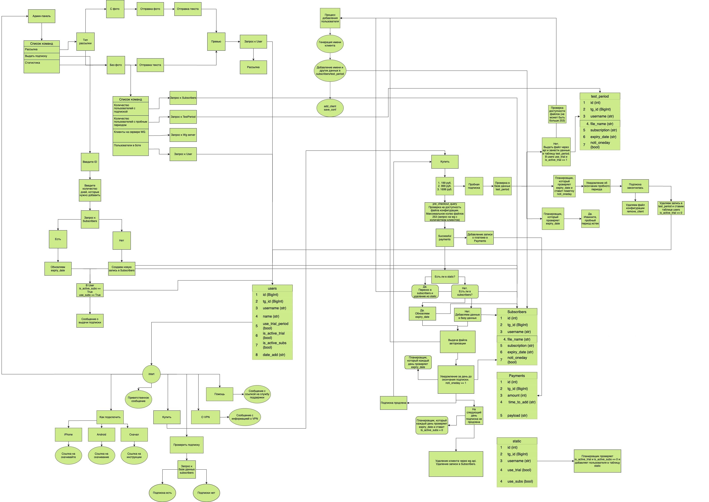

# Телеграм-бот для сервиса подписки на VPN 🚀

Это телеграм-бот, который управляет подписками на VPN, предоставляя пользователям доступ к VPN-файлам в зависимости от статуса их подписки. Бот отправляет уведомления пользователям за день до окончания подписки и управляет назначением VPN-файлов в зависимости от продления или истечения подписки. Также в боте встроена функция оплаты подписки через сервис Юкасса 💳.

## Особенности ✨

- **Управление подписками**: Пользователи могут подписаться на ежемесячную, полугодовую или годовую подписку 📅.
- **Назначение файлов**: После оплаты пользователи получают конфигурационный файл WireGuard и ссылку подписки 3x-ui.
- **Уведомления об истечении подписки**: Бот отправляет пользователю уведомление за день до окончания подписки ⏰.
- **Окончание подписки**: Бот отзывает выданные подключения после окончания срока.
- **Обработка продления**: При продлении подписки файл остаётся назначенным тому же пользователю 🔒.
- **Оплата через Юкасса**: Встроенная функция оплаты подписки через сервис Юкасса. Пользователи могут оплачивать подписку прямо через бота 💳.

## Технологии 📋

- Python 3.11+
- Telegram Bot API
- SQLAlchemy для управления базой данных
- SQLite3
- Aiogram (асинхронное API для телеграм-ботов)
- VPN-конфигурационные файлы 🛠️
- Юкасса API для обработки платежей 💸

## Архитектура бота и БД



## Установка

1. Установите зависимости командой `python -m pip install -r requirements.txt`.
2. Укажите параметры в локальном `config.py`. Для существующей установки сохраните параметры Telegram, ЮKassa, базы и тарифов. Адреса и учётные данные используются из этого файла.

```python
TOKEN = "TELEGRAM_API_TOKEN"
PAYMENT_TOKEN = "PAYMENT_TOKEN_YKASSA"
ADMIN_ID = "TELEGRAM_ADMIN_ID"
DB_URL_USERS = "sqlite+aiosqlite:///db.sqlite3"
DIR_CONF = "app/auth"
MIN_PAY_RUB = 50

one_mounth_price = 200
one_mounth_fake_price = 250
six_mounth_price = 1000
six_mounth_fake_price = 1500
twelve_mounth_price = 1800
twelve_mounth_fake_price = 3000

WG_ADDRESS = "https://wg.example.com:51821"
WG_API = "WG_EASY_PASSWORD"
WG_VERIFY_SSL = True
WG_MAX_CLIENTS = 60

XUI_PANEL_ADDRESS = "https://panel.example.com/panel-base-path"
XUI_PANEL_USERNAME = ""
XUI_PANEL_PASSWORD = ""
XUI_API_TOKEN = ""
XUI_VERIFY_SSL = True
XUI_INBOUND_IDS = {"reality": 1, "xhttp": 3, "hysteria2": 5, "xtls": 6}
XUI_SUBSCRIPTION_URL = ""  # Полный публичный префикс перед subId, если нужен override.
XUI_MAX_CLIENTS = 0
XUI_CLIENT_TOTAL_GB = 100
XUI_CLIENT_LIMIT_IP = 2
XUI_TRAFFIC_RESET_DAY = 1
VPN_TIMEZONE = "Europe/Moscow"

VPN_INSTRUCTION_VLESS = "https://teletype.in/@zenithvpn/editor/vless"
VPN_INSTRUCTION_IOS_URL = "https://teletype.in/@zenithvpn/ogi7tHwL4qV"
VPN_INSTRUCTION_ANDROID_URL = "https://teletype.in/@zenithvpn/N1lyKcbCMeV"
```

3. В 3x-ui включите сервер подписок и укажите ID четырёх настроенных входящих подключений. Если публичная подписка доступна через прокси по отдельному адресу, укажите в `XUI_SUBSCRIPTION_URL` полный префикс, например `https://sub.example.com/sub/`. Для ограничения по IP включите механизм IP Limit в панели. При включённой 2FA используйте `XUI_API_TOKEN`.
4. Запустите бота командой `python main.py`.

## Сверка с API 3x-ui

| Раздел | Что проверено и изменено |
| --- | --- |
| [Аутентификация](https://docs.sanaei.dev/ru/docs/reference/api/authentication/) и [API-токены](https://docs.sanaei.dev/ru/docs/reference/api/api-tokens/) | Раньше бот принимал только Bearer-токен. Теперь поддерживает его и сессию через `GET /csrf-token` и `POST /login`. Управление токенами остаётся в панели. |
| [Входящие подключения](https://docs.sanaei.dev/ru/docs/reference/api/inbounds/) | Сохранён `GET /panel/api/inbounds/options`. Вместо автоматического выбора всех подходящих записей бот проверяет четыре заданных ID, протоколы, транспорт, защиту и поддержку Vision на Reality и XTLS. |
| [Клиенты](https://docs.sanaei.dev/ru/docs/reference/api/clients/) | Сохранены `add`, `get/{email}`, `update/{email}`, `del/{email}` и `traffic/{email}`. Поиск читает `obj.client` и `obj.inboundIds`. Для восстановления после частичной выдачи добавлен `POST /panel/api/clients/{email}/attach`. Срок меняется частичным обновлением, а подсчёт использует `GET /panel/api/clients/list/paged` и `obj.total`. Методы `links/{email}` и `subLinks/{subId}` остаются в API, бот выдаёт единый URL подписки. |
| [Настройки](https://docs.sanaei.dev/ru/docs/reference/api/settings/) и [сервер подписок](https://docs.sanaei.dev/ru/docs/reference/api/subscription-server/) | Сохранён `POST /panel/api/setting/all`. Бот берёт публичный префикс из настроек или из `config.py` и добавляет к нему `subId`. Случайный путь панели поддерживается. |
| [Сервер](https://docs.sanaei.dev/ru/docs/reference/api/server/), [Xray](https://docs.sanaei.dev/ru/docs/reference/api/xray-settings/), [хосты](https://docs.sanaei.dev/ru/docs/reference/api/hosts/), [узлы](https://docs.sanaei.dev/ru/docs/reference/api/nodes/), [резервное копирование](https://docs.sanaei.dev/ru/docs/reference/api/backup/) и [WebSocket](https://docs.sanaei.dev/ru/docs/reference/api/websocket/) | Эти разделы не задействованы в выдаче доступа и остались вне интеграции. |

3x-ui применяет одну общую квоту к клиенту, прикреплённому к четырём входящим подключениям. Бот задаёт `totalGB` в байтах, `limitIp=2` и `trafficReset="monthly"` с выбранным днём месяца. Поля автопродления срока выключены, поэтому статистика сбрасывается отдельно от даты окончания. XTLS Vision выставляется для клиента, панель применяет его к совместимым входящим подключениям. [Реализация сброса в 3x-ui](https://github.com/MHSanaei/3x-ui/blob/main/internal/web/job/periodic_traffic_reset_job.go) · [Транспорты и Vision](https://github.com/MHSanaei/3x-ui/blob/main/docs/content/docs/en/config/transports.mdx)

## Перенос действующих подписок

Укажите в `config.py` адрес WireGuard и параметры 3x-ui. Остановите бота на время переноса и передайте рабочую копию базы. Команда без `--apply` только выводит количество подходящих записей.

```bash
python migrate_vless.py --db ./db.sqlite3
python migrate_vless.py --db ./db.sqlite3 --apply
```

Скрипт создаёт резервную копию SQLite рядом с указанным файлом. Он добавляет VLESS к каждой действующей платной подписке WireGuard и к действующим пробным подпискам, сохраняя дату окончания и существующий WireGuard. Повторный запуск пропускает завершённые записи и достраивает частично созданных клиентов. После успешного переноса удаляется старая таблица `servers`. После запуска бота ссылка доступна пользователям в «Моих подписках».
